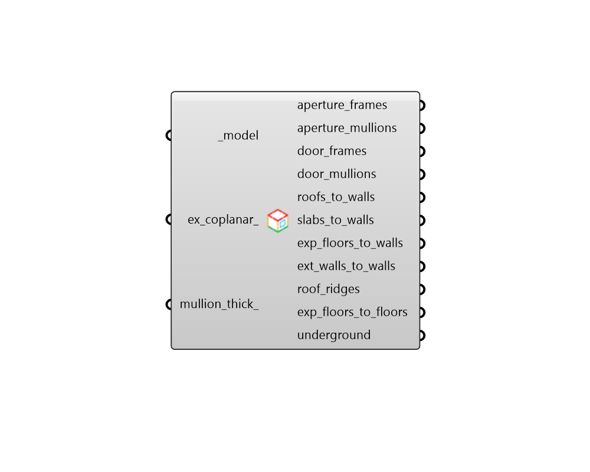

## Envelope Edges

 - [[source code]](https://github.com/ladybug-tools/honeybee-grasshopper-core/blob/master/honeybee_grasshopper_core/src//HB%20Envelope%20Edges.py)

Get the edges of a Model's envelope grouped based on the objects they adjoin. 

The edges returned by this component will only exist along the exterior envelope of the Model's rooms as defined by the contiguous volume across all interior adjacencies. In this way, edges that adjoin two honeybee rooms will only be represented once in the list (and not twice for the two rooms). 

The lengths of the resulting edges are useful for evaluating thermal bridges across the model. 

#### Inputs
* ##### model [Required]
A honeybee Model with rooms for which adjacencies have been solved. 
* ##### ex_coplanar 
Boolean to note whether edges falling between two coplanar Faces in the building envelope should be included in the result (False) or excluded from it (True). (Default: True). 
* ##### mullion_thick 
The maximum difference that apertures or doors can be from one another for the edges to be considered a mullion rather than a frame. If None, all edges of apertures and doors will be considered frames rather than mullions. 

#### Outputs
* ##### aperture_frames
A list of line segments for where exterior apertures meet their parent exterior wall or roof. 
* ##### aperture_mullions
A list of line segments for where exterior apertures meet one another. 
* ##### door_frames
A list of line segments for where exterior doors meet their parent exterior wall or roof. 
* ##### door_mullions
A list of line segments for where exterior doors meet one another. 
* ##### roofs_to_walls
A list of line segments where roofs meet exterior walls (or floors). Note that both the roof Face and the wall/floor Face must be next to one another in the model's outer envelope and have outdoor boundary conditions for the edge to show up in this list. 
* ##### slabs_to_walls
A list of line segments where ground floor slabs meet exterior walls or roofs. Note that the floor Face must have a ground boundary condition and the wall or roof Face must have an outdoor boundary condition for the edge between the two Faces to show up in this list. 
* ##### exp_floors_to_walls
A list of line segments where exposed floors meet exterior walls. Note that both the wall Face and the floor Face must be next to one another in the model's outer envelope and have outdoor boundary conditions for the edge to show up in this list. 
* ##### ext_walls_to_walls
A list of line segments where exterior walls meet one another. Note that both wall Faces must be next to one another in the model's outer envelope and have outdoor boundary conditions for the edge to show up in this list. 
* ##### roof_ridges
A list of line segments where exterior roofs meet one another. Note that both roof Faces must be next to one another in the model's outer envelope and have outdoor boundary conditions for the edge to show up in this list. 
* ##### exp_floors_to_floors
A list of line segments where exposed floors meet one another. Note that both floor Faces must be next to one another in the model's outer envelope and have outdoor boundary conditions for the edge to show up in this list. 
* ##### underground
A list of line segments where underground Faces meet one another. Note that both Faces must be next to one another in the model's outer envelope and have ground boundary conditions for the edge to show up in this list. 